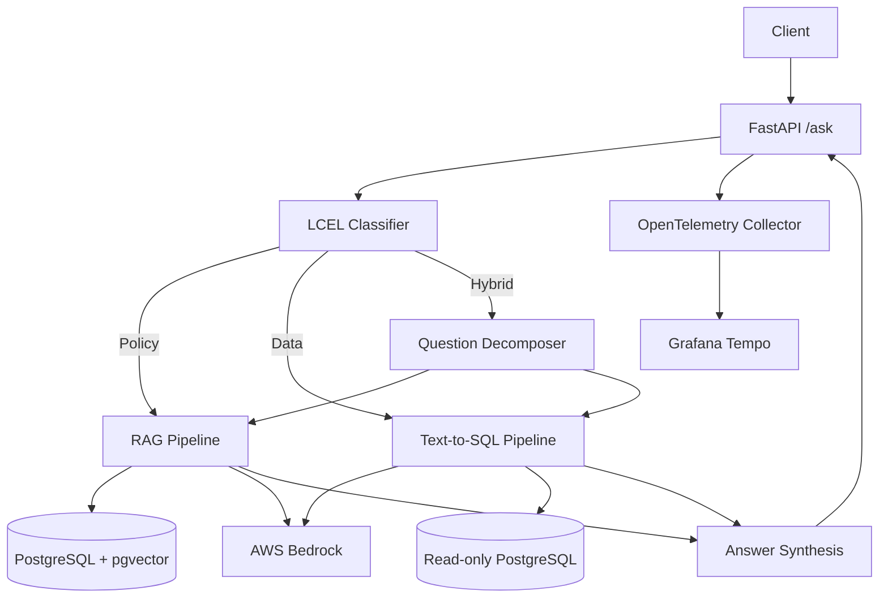

# Cabify-Lite — System Architecture

## 1. Overview

Cabify-Lite is a modular FastAPI application that combines
traditional ride-booking functionality with AI-powered
question answering over policy documents and PostgreSQL data.

The deployed application lives in `src/cabify_lite/` and runs
inside Docker Compose as the `rides-api` service.

## 2. High-level architecture

This is a routed AI workflow, not an autonomous
multi-agent system.

## 3. Application structure

| Module | Responsibility |
|---|---|
| `api/` | FastAPI endpoints and HTTP contracts |
| `ai/routing/` | Question classification and LCEL routing |
| `ai/rag/` | Policy retrieval, grounding and citations |
| `ai/sql/` | SQL generation, validation and execution |
| `ai/hybrid/` | Question decomposition and synthesis |
| `ai/providers/` | AWS Bedrock integration |
| `core/` | Configuration and application models |
| `db/` | PostgreSQL connectivity |
| `observability/` | Metrics and distributed tracing |

## 4. Policy RAG route

1. Classify the question as `policy`.
2. Generate a query embedding using Amazon Titan.
3. Search policy chunks stored in PostgreSQL/pgvector.
4. Pass retrieved context to Amazon Nova via Bedrock.
5. Validate citation references and return a grounded answer.

The retrieval corpus and ingestion assets are retained
under `week2/corpus/` and `week2/ingestion/`.

## 5. Data route

1. Classify the question as `data`.
2. Generate SQL from the user's question.
3. Validate SQL against permitted operations and tables.
4. Execute using restricted read-only database access.
5. Return an answer, generated SQL and result rows.

The current implementation includes SQL validation,
read-only transactions, statement timeouts and result limits.

These are layered safeguards, not a formal guarantee
that every generated query is semantically correct.

## 6. Hybrid route

A hybrid question requires both document knowledge
and structured database facts.

Example:

> What is the cancellation policy, and how many rides
> were cancelled in September 2026?

The workflow:

1. Classifies the question as `hybrid`.
2. Decomposes it into policy and data subquestions.
3. Executes RAG and SQL branches.
4. Combines the evidence into a final answer.
5. Returns citations and the generated SQL.

In the seeded demonstration database, September 2026
had 140 cancelled rides, independently verified as
90 rider cancellations and 50 driver cancellations.

## 7. Observability

The deployed application uses:

- OpenTelemetry for distributed traces.
- An OTLP Collector for telemetry ingestion.
- Grafana Tempo for trace storage and inspection.
- Prometheus for metrics collection.
- Grafana for visual analysis.

A live deployed hybrid request was retrieved from
Tempo with 21 spans, including:

- `ask_request`
- `classify`
- `embed_query`
- `retrieve`
- `llm_generate`
- `sql_generate`
- `sql_execute`

HTTP and PostgreSQL instrumentation produced additional
spans in the same trace.

## 8. Deployment

The application runs using:

- `docker-compose.yml`
- `Dockerfile.unified`
- `src/cabify_lite/main.py`

The local Compose-managed API is exposed on port 8000.

The original Week 1 and Week 2 source directories
remain in the repository pending final dependency
cleanup and reproducibility testing.

## 9. Evaluation

See [Evaluation History](EVALUATION_HISTORY.md).

The unified deployment retained the previous
17/20 (85%) answer-correctness result on the fixed
20-question evaluation suite.

## 10. Architectural trade-offs

**Why modular monolith?**

The application is small enough that independently
deployed AI services would add unnecessary networking,
configuration and operational complexity.

The modular structure still separates RAG, SQL,
hybrid orchestration, and model-provider integrations.

**Why PostgreSQL and pgvector?**

One database supports structured business records
and vector similarity search, reducing the number
of separate infrastructure components.

**Why routed workflows?**

Policy, data, and hybrid questions need different
execution strategies. Explicit routes make those
strategies easier to test, observe, and constrain.

**Why read-only SQL credentials?**

Generated SQL is untrusted. Database permissions
provide an important security boundary beyond
prompt instructions and application validation.
